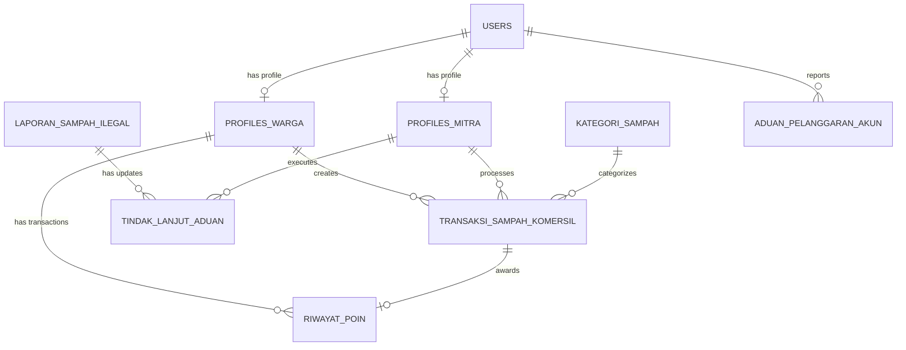

# Design Doc: Trash Management Modernization (Pragmatic MVP)

**Tanggal:** 2026-11-07  
**Status:** DRAFT (Menunggu Review & Persetujuan Pengguna)  
**Tujuan:** Mentransformasi proyek `trash-management` menjadi studi kasus nyata berskala produksi (*production-grade portfolio case study*) dengan skema database bersih di TiDB Cloud Serverless (MySQL 8.0), arsitektur REST API modular, dan antarmuka modern yang siap diuji oleh siapa saja.

---

## 1. Konteks & Mengapa Perubahan Ini Diperlukan (Intent & Why)

Aplikasi `trash-management` sebelumnya dibangun sebagai monolitik Express + EJS dengan beberapa keterbatasan:
1. **Tidak Ada Alur Transaksi Nyata:** Sampah komersil tidak memiliki kategori berbobot (kg), harga patokan poin, maupun siklus status transaksi yang baku.
2. **Isu Pelaporan Liar:** Mengandalkan library `address.mac` di sisi server untuk melacak perangkat pelapor. Pada lingkungan cloud/container Docker di Azure VM, fungsi ini gagal mengenali pengguna karena hanya membaca MAC address virtual interface container.
3. **Integritas Database Rendah:** Tidak ada Foreign Key, index pencarian, timestamp audit (`created_at`, `updated_at`), serta struktur model yang terduplikasi.
4. **Target Deployment Modern:** Proyek perlu diselaraskan dengan cetak biru arsitektur: Backend Express Modular (Port 3003, RAM limit 512MB di Azure VM) + Frontend React SPA (Cloudflare Pages) + Database TiDB Cloud Serverless + Storage Cloudflare R2.

---

## 2. Tujuan, Batasan, dan Anti-Goals

### 2.1 Tujuan (Goals)
- **Kemudahan Akses Publik (Zero-Barrier Testing):** Siapa pun (penguji/rekruter) dapat mencoba melapor sampah liar secara instan dan melacak statusnya via **Kode Tiket unik** tanpa wajib login.
- **Siklus Bank Sampah Masuk Akal:** Warga dapat menyetorkan sampah berdasarkan kategori terstandar (Plastik, Kertas, Logam, Minyak, Elektronik), estimasi bobot, dan kalkulasi poin otomatis.
- **Penanganan Nyata oleh DLH (Pemerintah):** Mitra pemerintah dapat menindaklanjuti laporan dengan bukti foto sesudah penanganan (*Before vs After clean-up*).
- **Integritas Database MySQL 8.0 (TiDB Cloud):** Relasi tabel ber-foreign key dengan cascade yang aman, tipe data presisi (DECIMAL untuk koordinat GPS), dan ledger mutasi poin.

### 2.2 Batasan (Constraints)
- Menggunakan database **TiDB Cloud Serverless** (koneksi wajib SSL/TLS, port 4000).
- Penyimpanan berkas foto/media wajib menggunakan **Cloudflare R2** via S3 SDK (tidak menyimpan berkas di disk lokal container).
- Alokasi memori backend di container maksimal **512 MB RAM**.

### 2.3 Hal yang Dihindari (Anti-Goals / Out of Scope)
- ❌ Tidak membuat sistem pembayaran uang tunai riil / integrasi payment gateway perbankan (cukup sistem poin / saldo simulasi).
- ❌ Tidak membuat sistem KYC / verifikasi KTP berbelit-belit yang menyulitkan pengujian publik.
- ❌ Tidak membuat sistem rute truk GPS live tracking yang rumit.

---

## 3. Pendekatan yang Dipilih (Approaches)

### Pendekatan yang Dipertimbangkan:
1. **Pendekatan A (Pragmatic MVP - Terpilih):** Menata skema tabel inti menjadi 8 entitas yang logis, alur status yang tegas, sistem kode tiket untuk aduan publik, dan mutasi poin otomatis. Cepat dibangun, elegan, dan mudah dicoba siapa saja.
2. **Pendekatan B (Full Enterprise Platform):** Menambahkan payment gateway rupiah, verifikasi KTP, komplain berjenjang, dan routing armada truk. *Ditolak karena memakan waktu lama dan menghambat pengujian publik.*
3. **Pendekatan C (Minimal Bugfix Saja):** Hanya memperbaiki driver `mysql2` tanpa membenahi model bisnis. *Ditolak karena tidak menyelesaikan masalah studi kasus nyata.*

---

## 4. Spesifikasi Skema Database Baru (`db_trash`)

Skema dirancang bersih, terindeks, dan mendukung Foreign Keys penuh:

### Rincian Tabel:

1. **`users`**
   - `id_user` INT AUTO_INCREMENT PRIMARY KEY
   - `nama` VARCHAR(100) NOT NULL
   - `email` VARCHAR(150) NOT NULL UNIQUE
   - `password` VARCHAR(255) NOT NULL (Bcrypt)
   - `role` ENUM('admin', 'warga', 'mitra') NOT NULL DEFAULT 'warga'
   - `status` ENUM('active', 'frozen', 'blocked') NOT NULL DEFAULT 'active'
   - `created_at` TIMESTAMP DEFAULT CURRENT_TIMESTAMP
   - `updated_at` TIMESTAMP DEFAULT CURRENT_TIMESTAMP ON UPDATE CURRENT_TIMESTAMP

2. **`profiles_warga`**
   - `id_warga` INT AUTO_INCREMENT PRIMARY KEY
   - `id_user` INT NOT NULL UNIQUE (FK `users.id_user` ON DELETE CASCADE)
   - `jenis_kelamin` ENUM('L', 'P') NULL
   - `no_telp` VARCHAR(20) NULL
   - `alamat` TEXT NULL
   - `provinsi` VARCHAR(100) NULL
   - `kota` VARCHAR(100) NULL
   - `kecamatan` VARCHAR(100) NULL
   - `kelurahan` VARCHAR(100) NULL
   - `total_poin` INT NOT NULL DEFAULT 0
   - `created_at`, `updated_at`

3. **`profiles_mitra`**
   - `id_mitra` INT AUTO_INCREMENT PRIMARY KEY
   - `id_user` INT NOT NULL UNIQUE (FK `users.id_user` ON DELETE CASCADE)
   - `jenis_mitra` ENUM('pemerintah', 'non-pemerintah') NOT NULL
     *(pemerintah = Dinas Lingkungan Hidup / Pemda; non-pemerintah = Bank Sampah / Pengepul)*
   - `instansi_nama` VARCHAR(150) NOT NULL
   - `no_telp` VARCHAR(20) NULL
   - `alamat` TEXT NULL
   - `kota` VARCHAR(100) NOT NULL
   - `kecamatan` VARCHAR(100) NOT NULL
   - `created_at`, `updated_at`

4. **`kategori_sampah`**
   - `id_kategori` INT AUTO_INCREMENT PRIMARY KEY
   - `nama_kategori` VARCHAR(100) NOT NULL *(Plastik, Kertas & Karton, Logam, Minyak Jelantah, Elektronik)*
   - `poin_per_kg` INT NOT NULL DEFAULT 10
   - `estimasi_harga_per_kg` DECIMAL(10,2) DEFAULT 0.00
   - `deskripsi` VARCHAR(255) NULL
   - `is_active` BOOLEAN DEFAULT TRUE

5. **`transaksi_sampah_komersil`** *(Bank Sampah)*
   - `id_transaksi` INT AUTO_INCREMENT PRIMARY KEY
   - `kode_transaksi` VARCHAR(30) NOT NULL UNIQUE *(Contoh: TRX-2611-001)*
   - `id_warga` INT NOT NULL (FK `profiles_warga.id_warga`)
   - `id_mitra` INT NULL (FK `profiles_mitra.id_mitra`)
   - `id_kategori` INT NOT NULL (FK `kategori_sampah.id_kategori`)
   - `estimasi_berat_kg` DECIMAL(6,2) NOT NULL
   - `berat_aktual_kg` DECIMAL(6,2) NULL
   - `total_poin_diperoleh` INT DEFAULT 0
   - `foto_sampah_url` VARCHAR(255) NULL *(Cloudflare R2)*
   - `alamat_jemput` TEXT NOT NULL
   - `kota` VARCHAR(100) NOT NULL
   - `kecamatan` VARCHAR(100) NOT NULL
   - `latitude` DECIMAL(10,8) NULL
   - `longitude` DECIMAL(11,8) NULL
   - `status` ENUM('MENUNGGU_PENJEMPUTAN', 'DIKONFIRMASI_MITRA', 'SELESAI', 'DIBATALKAN') DEFAULT 'MENUNGGU_PENJEMPUTAN'
   - `catatan_warga` TEXT NULL
   - `catatan_mitra` TEXT NULL
   - `tanggal_transaksi` TIMESTAMP DEFAULT CURRENT_TIMESTAMP
   - `tanggal_selesai` TIMESTAMP NULL

6. **`riwayat_poin`** *(Ledger Poin Warga)*
   - `id_riwayat` INT AUTO_INCREMENT PRIMARY KEY
   - `id_warga` INT NOT NULL (FK `profiles_warga.id_warga`)
   - `id_transaksi` INT NULL (FK `transaksi_sampah_komersil.id_transaksi`)
   - `perubahan_poin` INT NOT NULL *(Nilai positif jika bertambah)*
   - `tipe` ENUM('EARN_TRANSAKSI', 'REDEEM_REWARD', 'PENYESUAIAN_ADMIN') NOT NULL
   - `keterangan` VARCHAR(255) NOT NULL
   - `created_at` TIMESTAMP DEFAULT CURRENT_TIMESTAMP

7. **`laporan_sampah_ilegal`** *(Aduan Sampah Liar Publik)*
   - `id_laporan` INT AUTO_INCREMENT PRIMARY KEY
   - `kode_tiket` VARCHAR(30) NOT NULL UNIQUE *(Contoh: LAPOR-2611-8921)*
   - `id_user` INT NULL (FK `users.id_user`) *(NULL untuk pelapor tamu/anonim)*
   - `id_mitra_penangan` INT NULL (FK `profiles_mitra.id_mitra`) *(DLH terkait)*
   - `nama_pelapor` VARCHAR(100) DEFAULT 'Warga Anonim'
   - `nomor_kontak` VARCHAR(20) NOT NULL *(WhatsApp/Telp)*
   - `client_device_id` VARCHAR(100) NULL *(Client UUID untuk pencegahan spam)*
   - `deskripsi_kejadian` TEXT NOT NULL
   - `foto_bukti_url` VARCHAR(255) NOT NULL *(Cloudflare R2)*
   - `video_bukti_url` VARCHAR(255) NULL *(Cloudflare R2)*
   - `alamat_lokasi` TEXT NOT NULL
   - `kota` VARCHAR(100) NOT NULL
   - `kecamatan` VARCHAR(100) NOT NULL
   - `latitude` DECIMAL(10,8) NOT NULL
   - `longitude` DECIMAL(11,8) NOT NULL
   - `status` ENUM('MENUNGGU_VERIFIKASI', 'INVESTIGASI', 'DALAM_PENANGANAN', 'SELESAI_DIBERSIHKAN', 'DITOLAK') DEFAULT 'MENUNGGU_VERIFIKASI'
   - `created_at` TIMESTAMP DEFAULT CURRENT_TIMESTAMP
   - `updated_at` TIMESTAMP DEFAULT CURRENT_TIMESTAMP ON UPDATE CURRENT_TIMESTAMP

8. **`tindak_lanjut_aduan`** *(Laporan Progres Pembersihan oleh DLH)*
   - `id_tindak_lanjut` INT AUTO_INCREMENT PRIMARY KEY
   - `id_laporan` INT NOT NULL (FK `laporan_sampah_ilegal.id_laporan` ON DELETE CASCADE)
   - `id_mitra` INT NOT NULL (FK `profiles_mitra.id_mitra`)
   - `keterangan_tindakan` TEXT NOT NULL
   - `foto_bukti_penanganan_url` VARCHAR(255) NULL *(Foto lokasi setelah bersih)*
   - `created_at` TIMESTAMP DEFAULT CURRENT_TIMESTAMP

9. **`aduan_pelanggaran_akun`** *(Pusat Moderasi Abuse oleh Admin)*
   - `id_pelanggaran` INT AUTO_INCREMENT PRIMARY KEY
   - `id_pelapor_user` INT NOT NULL (FK `users.id_user`)
   - `id_terlapor_user` INT NULL (FK `users.id_user`)
   - `terlapor_device_id` VARCHAR(100) NULL
   - `jenis_pelanggaran` ENUM('KOMERSIL_PALSU', 'ADUAN_LIAR_FIKTIF', 'PERILAKU_BURUK', 'LAINNYA') NOT NULL
   - `alasan` TEXT NOT NULL
   - `bukti_url` VARCHAR(255) NULL
   - `status_review` ENUM('PENDING', 'DITINJAU_ADMIN', 'DISANKSI', 'DITOLAK') DEFAULT 'PENDING'
   - `created_at` TIMESTAMP DEFAULT CURRENT_TIMESTAMP

---

## 5. Berkas DDL SQL Siap Impor (`database/db_trash.sql`)

Seluruh DDL di atas telah dikonstruksikan lengkap dengan indeks performa, constraint Foreign Key, dan data awal (*seeders*) untuk `kategori_sampah` dan akun default Admin/Mitra/Warga. Berkas ini siap di-eksekusi langsung ke TiDB Cloud Serverless.
