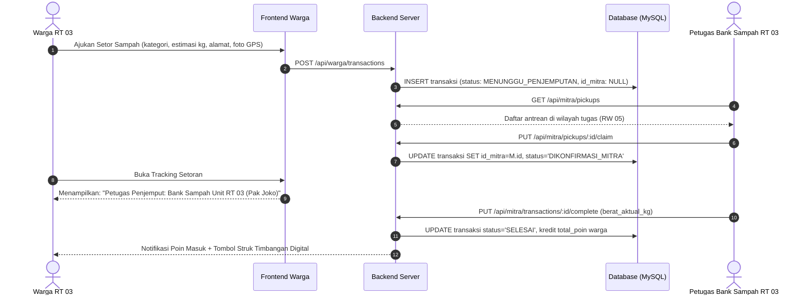
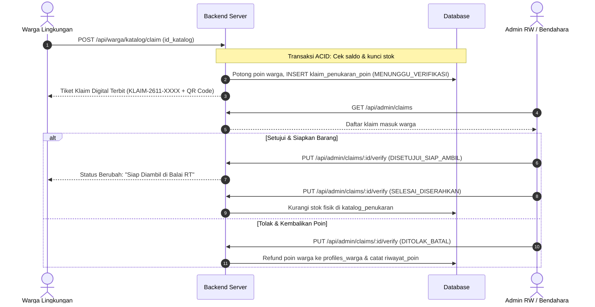

# Design Specification: Civic Logistics Dispatch, Point Redemption Validation, and Credibility Pack

**Document ID:** `SPEC-2026-11-08-CIVIC-LOGISTICS-REWARD-APPROVAL`  
**Date:** 2026-11-08  
**Scope:** `trash-management` (Komunitas Paguyuban RT/RW & Bank Sampah Unit RW 05 Kalirungkut)  
**Status:** Approved for Planning  

---

## 1. Context & Motivation

Aplikasi Trash Management telah memiliki pemisahan peran (RBAC) yang bersih antara Warga (penyetor), Mitra (satgas/bank sampah unit), dan Admin RW (pengawas). Namun, untuk memiliki kredibilitas teknis dan operasional yang tinggi di hadapan penguji/rekruter (*bukan sekadar CRUD pencatatan biasa*), sistem memerlukan:
1. **Logistik Penjemputan Berbasis Lokasi & Task Claiming (Dispatching):** Petugas bank sampah unit dapat mengambil/mengklaim tugas penjemputan warga di wilayah zonanya, sehingga warga dapat melacak identitas petugas yang menjemput secara transparan.
2. **Alur Klaim & Validasi Penukaran Poin Dua Arah (Two-Step Redemption & Admin Approval):** Warga mengajukan penukaran poin &rarr; Admin/Bendahara memvalidasi & menyetujui klaim &rarr; Stok fisik berkurang saat barang diserahkan di Balai RT &rarr; Warga memegang voucher digital dengan QR Code.
3. **Sandbox / Simulasi Demo Pengujian:** Fitur suntik saldo poin uji coba agar reviewer/penguji dapat langsung mendemokan penukaran sembako seketika.
4. **Paket Kredibilitas Ilmiah & Integritas Bukti:**
   - *Automated GPS & Timestamp Watermarking* pada foto bukti lapangan via Canvas.
   - *Kalkulator Dampak Ekologis KLHK* (\(\text{kg CO}_2\text{e}\), liter air bersih terselamatkan).
   - *Digital Receipt (Struk Penimbangan Resmi)* dengan QR verifikasi siap cetak/PDF.

---

## 2. Arsitektur & Model Data

### 2.1. Tabel Baru: `klaim_penukaran_poin`
```sql
CREATE TABLE IF NOT EXISTS `klaim_penukaran_poin` (
  `id_klaim` INT NOT NULL AUTO_INCREMENT,
  `kode_klaim` VARCHAR(30) NOT NULL UNIQUE,
  `id_warga` INT NOT NULL,
  `id_katalog` INT NOT NULL,
  `biaya_poin` INT NOT NULL,
  `nilai_rupiah` VARCHAR(50) NOT NULL,
  `status_klaim` ENUM(
    'MENUNGGU_VERIFIKASI', 
    'DISETUJUI_SIAP_AMBIL', 
    'SELESAI_DISERAHKAN', 
    'DITOLAK_BATAL'
  ) NOT NULL DEFAULT 'MENUNGGU_VERIFIKASI',
  `catatan_admin` TEXT NULL,
  `tanggal_pengajuan` TIMESTAMP NOT NULL DEFAULT CURRENT_TIMESTAMP,
  `tanggal_verifikasi` TIMESTAMP NULL,
  PRIMARY KEY (`id_klaim`),
  INDEX `idx_klaim_warga` (`id_warga`),
  INDEX `idx_klaim_status` (`status_klaim`),
  CONSTRAINT `fk_klaim_warga` FOREIGN KEY (`id_warga`) REFERENCES `profiles_warga` (`id_warga`) ON DELETE CASCADE,
  CONSTRAINT `fk_klaim_katalog` FOREIGN KEY (`id_katalog`) REFERENCES `katalog_penukaran` (`id_katalog`) ON DELETE CASCADE
) ENGINE=InnoDB DEFAULT CHARSET=utf8mb4 COLLATE=utf8mb4_unicode_ci;
```

### 2.2. Pembaruan Status Alur Penjemputan (`transaksi_sampah_komersil`)
- `MENUNGGU_PENJEMPUTAN`: Warga mengajukan jadwal setor sampah. `id_mitra` masih `NULL`.
- `DIKONFIRMASI_MITRA`: Petugas mengklaim tugas (`id_mitra` terisi akun petugas). Warga melihat nama petugas & nomor kontak.
- `SELESAI`: Petugas tiba, menimbang fisik sampah (`berat_aktual_kg`), menerbitkan poin dan struk digital resmi.
- `DIBATALKAN`: Dibatalkan oleh warga atau petugas dengan alasan jelas.

---

## 3. Alur Kerja Pengguna (User Workflows)

### Alur A: Logistik Penjemputan & Tracking Real-time


### Alur B: Penukaran Poin & Validasi Admin


---

## 4. Paket Fitur Kredibilitas

1. **Watermarking Canvas:**
   Fungsi `compressAndWatermarkImage()` mencetak banner transparan gelap di bagian bawah foto dengan teks monospaced putih:
   `TRASHMANAGE FIELD INSPECTION | [LAT, LNG] | [TIMESTAMP WIB] | RT 03 / RW 05`
2. **Kalkulator Ilmiah KLHK:**
   - Reduksi Emisi: \( \text{Berat (kg)} \times 2.15 = \dots \text{ kg CO}_2\text{e} \)
   - Penyelamatan Air Tanah: \( \text{Liter Minyak Jelantah} \times 1.000 = \dots \text{ Liter Air Bersih} \)
   - Diversi TPA: \( \frac{\text{Kg Terdaur Ulang}}{\text{Estimasi Timbulan}} \times 100\% \)
3. **Struk Timbangan Digital (Nota PDF):**
   - Komponen modal pop-up yang merender format nota kasir/bank sampah resmi ber-QR Code dengan tombol `Cetak / Unduh PDF`.
4. **Simulasi Pengujian Cepat:**
   - Tombol pengujian di modal warga: `+100 Poin Uji Coba` untuk memudahkan reviewer/penguji mendemokan fitur tanpa menunggu transaksi fisik.
